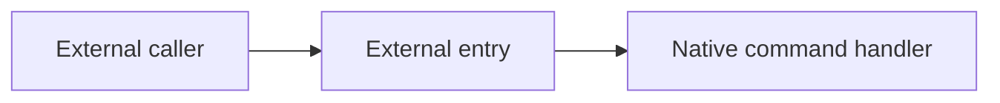

# Reverse Audit Knowledge Base Implementation Plan

> **For agentic workers:** REQUIRED SUB-SKILL: Use superpowers:subagent-driven-development (recommended) or superpowers:executing-plans to implement this plan task-by-task. Steps use checkbox (`- [ ]`) syntax for tracking.

**Goal:** Build a small TypeScript CLI and Markdown convention that lets humans and AI reverse-engineering agents understand a Target, track Reviewed and unreviewed areas, preserve resumable Investigations, and refresh a human-friendly Panorama.

**Architecture:** Markdown under `targets/` is the only source of truth. A headless core loads and validates one Target, renders compact Agent context, and atomically replaces only marked generated regions in `PANORAMA.md`; the CLI exposes that core through `context` and `checkpoint` while remaining independent of Obsidian and reverse-engineering MCP tools.

**Tech Stack:** Node.js 22+, TypeScript 5, npm, `gray-matter`, `zod`, Vitest, Mermaid embedded in Markdown

**Spec:** `docs/superpowers/specs/2026-09-01-reverse-audit-knowledge-base-design.md`

## Global Constraints

- Markdown is the only authoritative store; caches and generated regions must be reproducible.
- The implementation is binary-type neutral: APK, DEX, SO, KO, executables, firmware, and other Artifact types use the same data model.
- Each logical Target owns one mandatory `PANORAMA.md` with a human-maintained overall business/data-flow Mermaid diagram.
- `reviewed` means a declared scope was examined; it never means safe or vulnerability-free.
- Findings contain confirmed vulnerabilities only; suspected vulnerabilities remain Investigations.
- Incorrect Knowledge is corrected or deleted from the current model.
- Old Snapshots and Artifact hashes remain available for version comparison.
- The first version exposes only `revkb context demo-target` and `revkb checkpoint demo-target` as user-facing commands.
- The CLI does not call IDA, Ghidra, debuggers, MCP tools, Obsidian, or Git.
- Checkpoint must not modify hand-maintained text outside explicit generated-region markers.
- Any hard validation error must result in zero file writes.
- Current workspace note: this directory is not a Git repository. Obtain explicit approval before running `git init`; the commit steps below assume that approval has been given.

## Planned File Map

```text
package.json                         npm metadata, scripts, and `revkb` binary
package-lock.json                    pinned dependency graph generated by npm
tsconfig.json                        strict Node ESM TypeScript build
src/model.ts                         shared domain types and status constants
src/markdown/parse-note.ts           frontmatter, headings, sections, and wikilink parsing
src/workspace/load-target.ts         Target discovery and note loading
src/validation/artifact-table.ts     Snapshot Artifact table parsing
src/validation/validate-target.ts    hard errors, warnings, link and Snapshot rules
src/panorama/architecture-areas.ts   Panorama Mermaid area-marker extraction
src/panorama/generated-regions.ts    safe generated-region replacement
src/panorama/render-panorama.ts      coverage, Investigation, Lead, and Finding tables
src/context/build-context.ts         compact Agent context rendering
src/checkpoint/run-checkpoint.ts     validate-then-render atomic workflow
src/cli.ts                           two-command terminal adapter
templates/target/                    human-readable example pages for new Targets
docs/reverse-audit-workflow.md       shared Codex/Claude reverse-audit workflow
AGENTS.md                            Codex pointer to the shared workflow
CLAUDE.md                            Claude Code pointer to the shared workflow
README.md                            installation, command, and Vault-format guide
tests/fixtures/valid/                complete small Target used by tests
tests/fixtures/invalid/              focused malformed Targets
tests/golden/context.txt             expected compact context
tests/                               unit, integration, and CLI tests
```

---

### Task 1: Load a Target from human-readable Markdown

**Files:**
- Create: `package.json`
- Create: `package-lock.json`
- Create: `tsconfig.json`
- Create: `src/model.ts`
- Create: `src/markdown/parse-note.ts`
- Create: `src/workspace/load-target.ts`
- Create: `tests/fixtures/valid/targets/demo-target/PANORAMA.md`
- Create: `tests/fixtures/valid/targets/demo-target/snapshots/demo-v0.md`
- Create: `tests/fixtures/valid/targets/demo-target/snapshots/demo-v1.md`
- Create: `tests/fixtures/valid/targets/demo-target/knowledge/external-entry.md`
- Create: `tests/fixtures/valid/targets/demo-target/investigations/auth-bypass.md`
- Create: `tests/fixtures/valid/targets/demo-target/findings/confirmed-command-injection.md`
- Create: `tests/fixtures/valid/targets/demo-target/evidence/runtime-trace.md`
- Create: `tests/parse-note.test.ts`
- Create: `tests/load-target.test.ts`

**Interfaces:**
- Consumes: Filesystem paths and the Markdown/frontmatter convention from the design spec.
- Produces: `parseNote()`, `extractSection()`, `loadTarget()`, `ParsedNote`, `TargetVault`, `NoteKind`, and `CoverageStatus` for every later task.

- [ ] **Step 1: Create the Node/TypeScript project configuration**

Create `package.json` with an ESM build and no CLI framework:

```json
{
  "name": "reverse-audit-knowledge-base",
  "version": "0.1.0",
  "private": true,
  "type": "module",
  "bin": {
    "revkb": "./dist/cli.js"
  },
  "engines": {
    "node": ">=22"
  },
  "scripts": {
    "build": "tsc -p tsconfig.json",
    "typecheck": "tsc -p tsconfig.json --noEmit",
    "test": "vitest run",
    "check": "npm run typecheck && npm test && npm run build"
  },
  "dependencies": {
    "gray-matter": "^4.0.3",
    "zod": "^3.24.2"
  },
  "devDependencies": {
    "@types/node": "^22.13.10",
    "tsx": "^4.19.3",
    "typescript": "^5.8.2",
    "vitest": "^3.0.8"
  }
}
```

Create `tsconfig.json`:

```json
{
  "compilerOptions": {
    "target": "ES2022",
    "module": "NodeNext",
    "moduleResolution": "NodeNext",
    "rootDir": "src",
    "outDir": "dist",
    "strict": true,
    "noUncheckedIndexedAccess": true,
    "exactOptionalPropertyTypes": true,
    "esModuleInterop": true,
    "forceConsistentCasingInFileNames": true,
    "skipLibCheck": true
  },
  "include": ["src/**/*.ts"]
}
```

Run `npm install` to generate `package-lock.json`.

Expected: npm completes successfully and records the exact dependency graph.

- [ ] **Step 2: Create a complete fixture Target**

Use this frontmatter shape across the fixture:

```yaml
---
kind: knowledge
target: demo-target
snapshot: demo-v1
status: reviewed
---
```

The fixture `PANORAMA.md` must contain a Mermaid area marker and all generated markers:

```md
---
kind: panorama
target: demo-target
snapshot: demo-v1
---

# Demo Target

## Current understanding

The demo receives external input, authenticates it, and dispatches a native command.

## Overall architecture



## Audit coverage
<!-- revkb:coverage:start -->
<!-- revkb:coverage:end -->

## Active investigations
<!-- revkb:investigations:start -->
<!-- revkb:investigations:end -->

## Unreviewed branches
<!-- revkb:leads:start -->
<!-- revkb:leads:end -->

## Confirmed findings
<!-- revkb:findings:start -->
<!-- revkb:findings:end -->
```

The Snapshot fixture must have this table:

```md
---
kind: snapshot
target: demo-target
snapshot: demo-v1
parent: demo-v0
---

# Demo Snapshot v1

| Type | Path | SHA-256 |
|---|---|---|
| so | artifacts/libdemo.so | aaaaaaaaaaaaaaaaaaaaaaaaaaaaaaaaaaaaaaaaaaaaaaaaaaaaaaaaaaaaaaaa |
```

Create `demo-v0.md` with the same table shape, no parent, and a different valid 64-character SHA-256. This makes the fixture exercise retained Snapshot history while keeping `demo-v1` active through the Panorama frontmatter.

Ensure the Knowledge, Investigation, Finding, and Evidence pages use the exact headings defined in the spec and valid wikilinks to one another.

- [ ] **Step 3: Write failing parser and loader tests**

Create `tests/parse-note.test.ts`:

```ts
import { describe, expect, it } from "vitest";
import { parseNote, extractSection } from "../src/markdown/parse-note.js";

describe("parseNote", () => {
  it("extracts frontmatter, title, sections, and wikilinks", () => {
    const note = parseNote(
      "/vault/targets/demo/knowledge/auth.md",
      "knowledge/auth.md",
      `---\nkind: knowledge\ntarget: demo\nsnapshot: v1\nstatus: reviewed\n---\n# Authentication\n\n## Evidence\n\nSee [[evidence/auth-trace|trace]].\n`,
    );

    expect(note.title).toBe("Authentication");
    expect(note.frontmatter.kind).toBe("knowledge");
    expect(note.wikilinks).toEqual(["evidence/auth-trace"]);
    expect(extractSection(note.body, "Evidence")).toContain("auth-trace");
  });
});
```

Create `tests/load-target.test.ts`:

```ts
import path from "node:path";
import { describe, expect, it } from "vitest";
import { loadTarget } from "../src/workspace/load-target.js";

const fixtureRoot = path.resolve("tests/fixtures/valid");

describe("loadTarget", () => {
  it("loads one Panorama and all supported note kinds", async () => {
    const target = await loadTarget(fixtureRoot, "demo-target");

    expect(target.targetId).toBe("demo-target");
    expect(target.panorama.frontmatter.kind).toBe("panorama");
    expect(new Set(target.notes.map((note) => note.frontmatter.kind))).toEqual(
      new Set(["panorama", "snapshot", "knowledge", "investigation", "finding", "evidence"]),
    );
  });
});
```

- [ ] **Step 4: Run the tests and verify the loading interface is missing**

Run: `npm test -- tests/parse-note.test.ts tests/load-target.test.ts`

Expected: FAIL because `parse-note.ts` and `load-target.ts` do not exist.

- [ ] **Step 5: Implement the domain types, Markdown parser, and Target loader**

Create `src/model.ts` with these public types:

```ts
export const noteKinds = ["panorama", "snapshot", "knowledge", "investigation", "finding", "evidence"] as const;
export type NoteKind = (typeof noteKinds)[number];

export const coverageStatuses = [
  "discovered",
  "queued",
  "analyzing",
  "reviewed",
  "blocked",
  "dismissed",
  "needs-revalidation",
] as const;
export type CoverageStatus = (typeof coverageStatuses)[number];

export interface NoteFrontmatter {
  kind?: unknown;
  target?: unknown;
  snapshot?: unknown;
  status?: unknown;
  parent?: unknown;
}

export interface ParsedNote {
  absolutePath: string;
  relativePath: string;
  slug: string;
  title: string;
  frontmatter: NoteFrontmatter;
  body: string;
  raw: string;
  wikilinks: string[];
}

export interface TargetVault {
  vaultRoot: string;
  targetRoot: string;
  targetId: string;
  panorama: ParsedNote;
  notes: ParsedNote[];
}
```

Implement `parseNote(absolutePath, relativePath, raw): ParsedNote` with `gray-matter`, the first H1 as `title`, and the regex `/\[\[([^\]|#]+)(?:#[^\]|]+)?(?:\|[^\]]+)?\]\]/g` for wikilink targets. Implement `extractSection(body, heading)` so it returns content until the next heading of the same or higher level.

Implement `loadTarget(vaultRoot, targetId)` using `node:fs/promises`, recursively loading only `.md` files under `targets/<targetId>`. Require exactly one root `PANORAMA.md`; sort all notes by `relativePath` so later rendering is deterministic.

- [ ] **Step 6: Run the focused tests and the TypeScript checker**

Run: `npm test -- tests/parse-note.test.ts tests/load-target.test.ts && npm run typecheck`

Expected: both test files PASS and TypeScript reports no errors.

- [ ] **Step 7: Commit the loading slice**

```bash
git add package.json package-lock.json tsconfig.json src tests/fixtures/valid tests/parse-note.test.ts tests/load-target.test.ts
git commit -m "feat: load reverse audit targets from markdown"
```

---

### Task 2: Validate structure, links, Artifacts, Findings, and Snapshot freshness

**Files:**
- Create: `src/validation/artifact-table.ts`
- Create: `src/validation/validate-target.ts`
- Create: `tests/validation.test.ts`
- Create: `tests/fixtures/invalid/targets/broken-target/PANORAMA.md`
- Create: `tests/fixtures/invalid/targets/broken-target/snapshots/broken-v1.md`
- Create: `tests/fixtures/invalid/targets/broken-target/knowledge/missing-evidence.md`
- Create: `tests/fixtures/invalid/targets/broken-target/findings/unconfirmed.md`

**Interfaces:**
- Consumes: `ParsedNote`, `TargetVault`, `noteKinds`, `coverageStatuses`, and `extractSection()` from Task 1.
- Produces: `Artifact`, `ValidationIssue`, `ValidationReport`, `parseArtifactTable()`, and `validateTarget()` for `context` and `checkpoint`.

- [ ] **Step 1: Write failing validation tests**

Create `tests/validation.test.ts` with focused cases:

```ts
import path from "node:path";
import { describe, expect, it } from "vitest";
import { loadTarget } from "../src/workspace/load-target.js";
import { validateTarget } from "../src/validation/validate-target.js";

describe("validateTarget", () => {
  it("accepts the complete fixture", async () => {
    const target = await loadTarget(path.resolve("tests/fixtures/valid"), "demo-target");
    expect(validateTarget(target).errors).toEqual([]);
  });

  it("reports malformed Artifacts, broken links, and missing reviewed evidence", async () => {
    const target = await loadTarget(path.resolve("tests/fixtures/invalid"), "broken-target");
    const report = validateTarget(target);
    expect(report.errors.map((issue) => issue.code)).toEqual(
      expect.arrayContaining(["invalid-artifact-hash", "broken-wikilink"]),
    );
    expect(report.warnings.map((issue) => issue.code)).toContain("reviewed-without-evidence");
  });

  it("warns instead of failing when Knowledge needs Snapshot revalidation", async () => {
    const target = await loadTarget(path.resolve("tests/fixtures/valid"), "demo-target");
    const knowledge = target.notes.find((note) => note.relativePath === "knowledge/external-entry.md");
    if (!knowledge) throw new Error("fixture Knowledge missing");
    knowledge.frontmatter.snapshot = "demo-v0";
    knowledge.frontmatter.status = "reviewed";

    expect(validateTarget(target).warnings.map((issue) => issue.code)).toContain("stale-snapshot");
  });

  it("rejects an unknown parent Snapshot and an unknown status", async () => {
    const target = await loadTarget(path.resolve("tests/fixtures/valid"), "demo-target");
    const snapshot = target.notes.find((note) => note.relativePath === "snapshots/demo-v1.md");
    const knowledge = target.notes.find((note) => note.relativePath === "knowledge/external-entry.md");
    if (!snapshot || !knowledge) throw new Error("fixture pages missing");
    snapshot.frontmatter.parent = "absent-snapshot";
    knowledge.frontmatter.status = "safe";

    const codes = validateTarget(target).errors.map((issue) => issue.code);
    expect(codes).toContain("missing-parent-snapshot");
    expect(codes).toContain("unknown-status");
  });
});
```

- [ ] **Step 2: Run the validation test and verify it fails**

Run: `npm test -- tests/validation.test.ts`

Expected: FAIL because `validate-target.ts` does not exist.

- [ ] **Step 3: Implement Artifact table parsing**

Create `src/validation/artifact-table.ts`:

```ts
import type { ParsedNote } from "../model.js";

export interface Artifact {
  type: string;
  path: string;
  sha256: string;
}

export function parseArtifactTable(note: ParsedNote): Artifact[] {
  const rows = note.body.split("\n").filter((line) => /^\|.+\|$/.test(line.trim()));
  return rows.slice(2).map((line) => {
    const [type = "", artifactPath = "", sha256 = ""] = line
      .split("|")
      .slice(1, -1)
      .map((cell) => cell.trim());
    return { type, path: artifactPath, sha256 };
  });
}
```

Validation must require at least one Artifact per Snapshot and require `/^[a-f0-9]{64}$/i` for every SHA-256.

- [ ] **Step 4: Implement one validation report with hard errors and warnings**

Create `src/validation/validate-target.ts` with these interfaces:

```ts
export interface ValidationIssue {
  severity: "error" | "warning";
  code: string;
  path: string;
  message: string;
}

export interface ValidationReport {
  errors: ValidationIssue[];
  warnings: ValidationIssue[];
}

export function validateTarget(target: TargetVault): ValidationReport;
```

Use `zod` to validate required string fields. Apply these exact rules:

- every page has a supported `kind`, matching `target`, and a `snapshot`;
- Knowledge and Investigation pages have a supported coverage `status`;
- Finding pages have `status: confirmed` and nonempty `## Evidence` content;
- every Snapshot has at least one valid Artifact and an existing parent when `parent` is present;
- the Panorama's `snapshot` names an existing Snapshot;
- every wikilink resolves to `<targetRoot>/<link>.md` or an exact Markdown file path under the Target;
- every `reviewed` Knowledge page has nonempty `## Evidence`, otherwise emit `reviewed-without-evidence`;
- every `analyzing` or `blocked` Investigation has nonempty `## Next action`, otherwise emit `missing-next-action`;
- Knowledge and Investigation pages scoped to a non-active Snapshot emit `stale-snapshot` unless their status is `needs-revalidation`;
- sort issues by path and then code for deterministic output.

- [ ] **Step 5: Build focused invalid fixtures**

Make `broken-target` loadable but structurally invalid: give its Snapshot a non-hex hash, give one Knowledge page a `[[knowledge/absent-page]]` link, mark that Knowledge `reviewed` with an empty `## Evidence` section, and give its Finding `status: suspected` with an empty Evidence section. This keeps each expected issue intentional and exercises the rule that suspected vulnerabilities remain Investigations.

- [ ] **Step 6: Run validation tests and the full suite**

Run: `npm test -- tests/validation.test.ts && npm run check`

Expected: validation tests PASS; the complete check passes.

- [ ] **Step 7: Commit validation**

```bash
git add src/validation tests/validation.test.ts tests/fixtures/invalid
git commit -m "feat: validate reverse audit knowledge"
```

---

### Task 3: Render compact Agent context and expose `revkb context`

**Files:**
- Create: `src/context/build-context.ts`
- Create: `src/cli.ts`
- Create: `tests/context.test.ts`
- Create: `tests/cli-context.test.ts`
- Create: `tests/golden/context.txt`

**Interfaces:**
- Consumes: `TargetVault`, `validateTarget()`, and `extractSection()`.
- Produces: `buildContext(target, report): string`, `runCli(args, cwd, io): Promise<number>`, and the first public CLI command.

- [ ] **Step 1: Write a failing golden test for Agent context**

Create `tests/context.test.ts`:

```ts
import fs from "node:fs/promises";
import path from "node:path";
import { describe, expect, it } from "vitest";
import { buildContext } from "../src/context/build-context.js";
import { loadTarget } from "../src/workspace/load-target.js";
import { validateTarget } from "../src/validation/validate-target.js";

it("renders deterministic compact context", async () => {
  const target = await loadTarget(path.resolve("tests/fixtures/valid"), "demo-target");
  const actual = buildContext(target, validateTarget(target));
  const expected = await fs.readFile("tests/golden/context.txt", "utf8");
  expect(actual).toBe(expected);
});
```

The golden output must use this order and omit Evidence bodies:

```text
# Reverse Audit Context: Demo Target

Active Snapshot: demo-v1

## Current Architecture
The demo receives external input, authenticates it, and dispatches a native command.

## High-risk Areas
- External entry — reviewed — [[knowledge/external-entry]]

## Active Investigations
- Authentication bypass — analyzing — Next: Trace the unauthenticated caller into the native dispatcher.

## Unreviewed Leads
None.

## Confirmed Findings
- Confirmed command injection — [[findings/confirmed-command-injection]]

## Warnings
None.
```

- [ ] **Step 2: Write a failing CLI adapter test**

Create `tests/cli-context.test.ts` with injected output streams:

```ts
import path from "node:path";
import { expect, it } from "vitest";
import { runCli } from "../src/cli.js";

it("runs the context command against cwd", async () => {
  let stdout = "";
  let stderr = "";
  const code = await runCli(
    ["context", "demo-target"],
    path.resolve("tests/fixtures/valid"),
    { out: (text) => (stdout += text), err: (text) => (stderr += text) },
  );
  expect(code).toBe(0);
  expect(stdout).toContain("# Reverse Audit Context: Demo Target");
  expect(stderr).toBe("");
});
```

- [ ] **Step 3: Run the context tests and verify they fail**

Run: `npm test -- tests/context.test.ts tests/cli-context.test.ts`

Expected: FAIL because `build-context.ts` and `cli.ts` do not exist.

- [ ] **Step 4: Implement deterministic context rendering**

Implement:

```ts
export function buildContext(target: TargetVault, report: ValidationReport): string;

export class TargetValidationError extends Error {
  override readonly name = "TargetValidationError";

  constructor(public readonly report: ValidationReport) {
    super("Target validation failed");
  }
}
```

Use the Panorama H1 for the Target label, its `## Current understanding` text for architecture, Knowledge pages for high-risk/coverage areas, `analyzing` and `blocked` Investigations for active work, `discovered`, `queued`, and `needs-revalidation` Investigations for unreviewed Leads, and every confirmed Finding for Findings. Extract the first nonempty line under `## Next action`; never inline `## Evidence`.

If `report.errors` is nonempty, `buildContext` must throw a `TargetValidationError` containing the report. Include warnings in the final section without failing.

- [ ] **Step 5: Implement the CLI adapter without a framework**

Create `src/cli.ts` with a shebang and an injectable adapter:

```ts
#!/usr/bin/env node
export interface CliIo {
  out(text: string): void;
  err(text: string): void;
}

export async function runCli(args: string[], cwd: string, io: CliIo): Promise<number>;
```

Accept exactly `context <target-id>` in this task. Return exit code `2` and print `Usage: revkb context <target-id> | revkb checkpoint <target-id>` for missing or extra arguments. Catch validation and filesystem errors, print concise path-aware messages to stderr, and return `1`.

The executable tail calls `runCli(process.argv.slice(2), process.cwd(), console adapters)` and assigns `process.exitCode`.

- [ ] **Step 6: Run focused and full checks**

Run: `npm test -- tests/context.test.ts tests/cli-context.test.ts && npm run check`

Expected: golden and CLI tests PASS; the build creates executable JavaScript at `dist/cli.js`.

- [ ] **Step 7: Commit the context slice**

```bash
git add src/context src/cli.ts tests/context.test.ts tests/cli-context.test.ts tests/golden/context.txt
git commit -m "feat: render compact reverse audit context"
```

---

### Task 4: Generate Panorama coverage while preserving hand-written content

**Files:**
- Create: `src/panorama/architecture-areas.ts`
- Create: `src/panorama/generated-regions.ts`
- Create: `src/panorama/render-panorama.ts`
- Create: `tests/panorama.test.ts`

**Interfaces:**
- Consumes: `TargetVault`, `ParsedNote`, validated wikilinks, and coverage statuses.
- Produces: `extractArchitectureAreas()`, `replaceGeneratedRegion()`, and `renderPanorama()` for Checkpoint.

- [ ] **Step 1: Write failing tests for architecture areas and generated-region safety**

Create `tests/panorama.test.ts`:

```ts
import path from "node:path";
import { describe, expect, it } from "vitest";
import { extractArchitectureAreas } from "../src/panorama/architecture-areas.js";
import { renderPanorama } from "../src/panorama/render-panorama.js";
import { loadTarget } from "../src/workspace/load-target.js";

describe("Panorama rendering", () => {
  it("extracts explicit Mermaid area markers", () => {
    expect(extractArchitectureAreas("%% revkb-area: [[knowledge/external-entry]]")).toEqual([
      "knowledge/external-entry",
    ]);
  });

  it("updates generated regions and preserves all manual text", async () => {
    const target = await loadTarget(path.resolve("tests/fixtures/valid"), "demo-target");
    const rendered = renderPanorama(target);
    expect(rendered).toContain("The demo receives external input");
    expect(rendered).toContain("| External entry | reviewed | demo-v1 |");
    expect(rendered).toContain("Authentication bypass");
    expect(rendered).toContain("Confirmed command injection");
  });

  it("rejects duplicate or reversed generated markers", async () => {
    const { replaceGeneratedRegion } = await import("../src/panorama/generated-regions.js");
    expect(() =>
      replaceGeneratedRegion(
        "<!-- revkb:coverage:end -->\n<!-- revkb:coverage:start -->",
        "coverage",
        "generated",
      ),
    ).toThrowError(/coverage markers/);
  });
});
```

Add a preservation assertion that removes the four generated regions from the original and rendered text and expects the remaining strings to be identical.

- [ ] **Step 2: Run the Panorama tests and verify they fail**

Run: `npm test -- tests/panorama.test.ts`

Expected: FAIL because the Panorama modules do not exist.

- [ ] **Step 3: Implement explicit architecture-area extraction**

Implement:

```ts
export function extractArchitectureAreas(markdown: string): string[];
```

Match only lines of the exact form `%% revkb-area: [[knowledge/path]]` inside the `## Overall architecture` section. Sort and deduplicate links. The explicit marker is the seam between the human-maintained diagram and machine-generated coverage; do not parse Mermaid node syntax.

- [ ] **Step 4: Implement strict generated-region replacement**

Implement:

```ts
export function replaceGeneratedRegion(
  source: string,
  name: "coverage" | "investigations" | "leads" | "findings",
  generatedMarkdown: string,
): string;
```

Require exactly one start marker and one end marker in the correct order. Preserve the marker lines, normalize the generated body to one leading and trailing newline, and leave every byte outside the two markers untouched. Throw a typed `GeneratedRegionError` before returning any content when markers are missing, duplicated, or reversed.

- [ ] **Step 5: Implement Panorama table and list rendering**

Implement:

```ts
export function renderPanorama(target: TargetVault): string;
```

Render coverage rows from the Knowledge pages referenced by architecture-area markers. Each row contains title, textual status, Snapshot, number of non-dismissed Investigation pages that link to the Knowledge page, and a wikilink to the detail page.

Render active Investigations from `analyzing` and `blocked`; render unreviewed Leads from `discovered`, `queued`, and `needs-revalidation`; render all confirmed Findings. Use `None.` for empty lists. Apply generated regions in a fixed order so output is deterministic.

- [ ] **Step 6: Run Panorama and full checks**

Run: `npm test -- tests/panorama.test.ts && npm run check`

Expected: all Panorama tests PASS, including byte preservation outside generated markers.

- [ ] **Step 7: Commit Panorama rendering**

```bash
git add src/panorama tests/panorama.test.ts
git commit -m "feat: render audit coverage into panorama"
```

---

### Task 5: Implement atomic Checkpoints and expose `revkb checkpoint`

**Files:**
- Create: `src/checkpoint/run-checkpoint.ts`
- Modify: `src/cli.ts`
- Create: `tests/checkpoint.test.ts`
- Create: `tests/cli-checkpoint.test.ts`

**Interfaces:**
- Consumes: `loadTarget()`, `validateTarget()`, and `renderPanorama()`.
- Produces: `runCheckpoint(vaultRoot, targetId): Promise<CheckpointResult>` and the second public CLI command.

- [ ] **Step 1: Write a failing zero-write test**

Create `tests/checkpoint.test.ts` using a temporary copied fixture:

```ts
import fs from "node:fs/promises";
import os from "node:os";
import path from "node:path";
import { expect, it } from "vitest";
import { runCheckpoint } from "../src/checkpoint/run-checkpoint.js";

it("does not write Panorama when validation has a hard error", async () => {
  const root = await fs.mkdtemp(path.join(os.tmpdir(), "revkb-checkpoint-"));
  await fs.cp("tests/fixtures/invalid", root, { recursive: true });
  const panoramaPath = path.join(root, "targets/broken-target/PANORAMA.md");
  const before = await fs.readFile(panoramaPath, "utf8");

  await expect(runCheckpoint(root, "broken-target")).rejects.toMatchObject({ name: "CheckpointError" });
  expect(await fs.readFile(panoramaPath, "utf8")).toBe(before);
});
```

Add a successful case that verifies generated content is written, the manual architecture section is unchanged, and no `.revkb-tmp` file remains.

- [ ] **Step 2: Run the Checkpoint test and verify it fails**

Run: `npm test -- tests/checkpoint.test.ts`

Expected: FAIL because `run-checkpoint.ts` does not exist.

- [ ] **Step 3: Implement validate-then-render atomic Checkpoint behavior**

Create `src/checkpoint/run-checkpoint.ts` with:

```ts
export interface CheckpointResult {
  panoramaPath: string;
  changed: boolean;
  warnings: ValidationIssue[];
}

export class CheckpointError extends Error {
  override readonly name = "CheckpointError";

  constructor(
    message: string,
    public readonly report?: ValidationReport,
    options?: ErrorOptions,
  ) {
    super(message, options);
  }
}

export async function runCheckpoint(vaultRoot: string, targetId: string): Promise<CheckpointResult>;
```

The implementation order is fixed:

1. load the Target;
2. validate all notes;
3. throw `CheckpointError` with the complete report if hard errors exist;
4. render the full prospective Panorama in memory;
5. return `changed: false` without writing when bytes are identical;
6. write a sibling temporary file using `open(tempPath, "wx")`;
7. write, sync, close, and rename the temporary file over `PANORAMA.md`;
8. remove the temporary file after any failure where it was created;
9. return sorted warnings.

Do not edit Knowledge, Investigation, Finding, Snapshot, or Evidence files.

- [ ] **Step 4: Write a failing CLI Checkpoint test**

Create `tests/cli-checkpoint.test.ts`:

```ts
import fs from "node:fs/promises";
import os from "node:os";
import path from "node:path";
import { expect, it } from "vitest";
import { runCli } from "../src/cli.js";

it("runs checkpoint and reports the changed Panorama", async () => {
  const root = await fs.mkdtemp(path.join(os.tmpdir(), "revkb-cli-"));
  await fs.cp("tests/fixtures/valid", root, { recursive: true });
  let stdout = "";
  const code = await runCli(["checkpoint", "demo-target"], root, {
    out: (text) => (stdout += text),
    err: () => undefined,
  });
  expect(code).toBe(0);
  expect(stdout).toContain("Updated targets/demo-target/PANORAMA.md");
});
```

- [ ] **Step 5: Add the Checkpoint branch to `runCli`**

For `checkpoint demo-target`, call `runCheckpoint(cwd, "demo-target")`. Print one of:

```text
Updated targets/demo-target/PANORAMA.md
No generated Panorama changes.
```

Then print warnings as `WARNING <code> <path>: <message>`. Keep usage errors at exit `2` and hard validation/filesystem errors at exit `1`.

- [ ] **Step 6: Run Checkpoint, CLI, and full checks**

Run: `npm test -- tests/checkpoint.test.ts tests/cli-checkpoint.test.ts && npm run check`

Expected: Checkpoint tests PASS; the full project builds and tests cleanly.

- [ ] **Step 7: Commit Checkpoint behavior**

```bash
git add src/checkpoint src/cli.ts tests/checkpoint.test.ts tests/cli-checkpoint.test.ts
git commit -m "feat: add atomic reverse audit checkpoints"
```

---

### Task 6: Add Target templates, shared Agent instructions, documentation, and end-to-end verification

**Files:**
- Create: `templates/target/PANORAMA.md`
- Create: `templates/target/snapshots/example-v1.md`
- Create: `templates/target/knowledge/example-area.md`
- Create: `templates/target/investigations/example-investigation.md`
- Create: `templates/target/findings/example-finding.md`
- Create: `templates/target/evidence/example-evidence.md`
- Create: `docs/reverse-audit-workflow.md`
- Create: `AGENTS.md`
- Create: `CLAUDE.md`
- Create: `README.md`
- Create: `tests/templates.test.ts`
- Create: `tests/e2e.test.ts`

**Interfaces:**
- Consumes: The complete CLI and Markdown convention from Tasks 1–5.
- Produces: Human-copyable Target pages, one shared Agent workflow, setup documentation, and acceptance-level CLI tests.

- [ ] **Step 1: Write failing template and end-to-end tests**

Create `tests/templates.test.ts`:

```ts
import fs from "node:fs/promises";
import { expect, it } from "vitest";

it("ships the mandatory human-facing Panorama sections", async () => {
  const template = await fs.readFile("templates/target/PANORAMA.md", "utf8");
  expect(template).toContain("## Overall architecture");
  expect(template).toContain("```mermaid");
  expect(template).toContain("%% revkb-area: [[knowledge/example-area]]");
  expect(template).toContain("<!-- revkb:coverage:start -->");
  expect(template).toContain("## Unreviewed branches");
});
```

Create `tests/e2e.test.ts` to build the CLI, copy the valid fixture into a temporary directory, run `node dist/cli.js context demo-target`, then run `node dist/cli.js checkpoint demo-target`. Assert both exit `0`, context does not include the runtime-trace body, and the resulting Panorama contains coverage, Investigation, and Finding links.

- [ ] **Step 2: Run the documentation-facing tests and verify they fail**

Run: `npm test -- tests/templates.test.ts tests/e2e.test.ts`

Expected: FAIL because templates and documentation do not exist.

- [ ] **Step 3: Create concise, complete Target templates**

Copy the validated fixture shapes into `templates/target/`, using `example-target` and `example-v1` consistently. The Panorama template must include:

- a one-paragraph `Current understanding` section;
- a small business/data-flow Mermaid graph;
- `%% revkb-area: [[knowledge/example-area]]` inside the Mermaid block;
- all four generated-region marker pairs;
- Key attack surfaces and Snapshots sections outside generated regions.

The Investigation template must include one concrete next-action sentence. The Finding template must use `status: confirmed` and contain a concrete Evidence Anchor example, so copying the template does not teach invalid structure.

- [ ] **Step 4: Write the shared Codex/Claude workflow**

Create `docs/reverse-audit-workflow.md` with these imperative rules:

```md
# Reverse Audit Agent Workflow

1. Start with `revkb context <target-id>` and choose one active Investigation.
2. Treat Artifact bytes and reproducible runtime behavior as authoritative.
3. Keep hypotheses inside Investigations; do not present them as Knowledge or Findings.
4. Use available static-analysis, dynamic-analysis, and MCP tools without copying verbose raw output into the Vault.
5. Checkpoint only after a stable architecture change, a new Lead, an Investigation transition, a Finding decision, a Snapshot change, or before ending the session.
6. Before Checkpoint, correct or delete disproved Knowledge, retain minimal reproducible Negative Audit Results, and write one concrete next action.
7. Keep `PANORAMA.md` human-readable and update its overall Mermaid architecture when the current model changes.
8. Run `revkb checkpoint <target-id>` and resolve hard errors before handing off.
```

Create `AGENTS.md` and `CLAUDE.md` as short pointers to this same file; do not duplicate the workflow text.

- [ ] **Step 5: Document installation and usage**

Create `README.md` with:

- the five questions the system answers;
- Node.js 22+ and `npm install` setup;
- `npm run build` and optional `npm link` instructions;
- the `targets/` directory map;
- how to copy `templates/target` to create a Target;
- `revkb context demo-target` and `revkb checkpoint demo-target` examples;
- the generated-region ownership rule;
- an explanation that Obsidian and MCP tools are optional adapters, not dependencies;
- a statement that `reviewed` does not mean safe.

- [ ] **Step 6: Run end-to-end and complete verification**

Run:

```bash
npm run check
npm pack --dry-run
node dist/cli.js context demo-target
```

For the last command, run from `tests/fixtures/valid` or provide that directory as the process working directory.

Expected:

- type checking, all tests, and build PASS;
- the package dry run includes `dist/cli.js`, templates, README, and workflow documentation;
- context output is compact and contains no verbose Evidence body;
- `revkb checkpoint demo-target` is idempotent on a second run;
- no test or Checkpoint changes hand-maintained Panorama text.

- [ ] **Step 7: Commit the completed MVP**

```bash
git add templates docs/reverse-audit-workflow.md AGENTS.md CLAUDE.md README.md tests/templates.test.ts tests/e2e.test.ts
git commit -m "docs: add reverse audit workflow and templates"
```

---

## Final Acceptance Walkthrough

- [ ] Copy `templates/target` to `targets/example-target` and confirm all pages are understandable in a plain Markdown viewer.
- [ ] Open `targets/example-target/PANORAMA.md` in Obsidian and confirm the Mermaid overview renders and wikilinks permit progressive drill-down.
- [ ] Run `revkb context example-target` and confirm it answers architecture, current coverage, active work, unreviewed branches, Findings, and next action without reading all evidence.
- [ ] Add a queued Investigation, run Checkpoint, and confirm it appears under Unreviewed branches.
- [ ] Mark a Knowledge page `reviewed` without Evidence and confirm Checkpoint warns.
- [ ] Break a required wikilink and confirm Checkpoint exits nonzero without modifying Panorama.
- [ ] Change the active Snapshot while leaving Knowledge on the old Snapshot and confirm a revalidation warning appears.
- [ ] Correct an old Knowledge conclusion, rerun Checkpoint, and confirm only the current conclusion remains visible.
- [ ] Run Checkpoint twice and confirm the second run reports no generated changes.
- [ ] Run `npm run check` once more and record the passing output in the implementation handoff.
