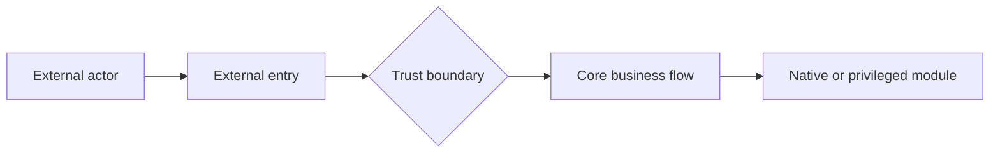

# Example Target

## Current understanding

The Target receives external input, crosses a trust boundary, and dispatches work to a privileged module.

## Overall architecture

## Key attack surfaces

- External input parsing
- Trust-boundary authorization
- Native or privileged dispatch

## Audit coverage
<!-- revkb:coverage:start -->
<!-- revkb:coverage:end -->

## Active investigations
<!-- revkb:investigations:start -->
<!-- revkb:investigations:end -->

## Unreviewed branches
<!-- revkb:leads:start -->
<!-- revkb:leads:end -->

## Confirmed findings
<!-- revkb:findings:start -->
<!-- revkb:findings:end -->

## Snapshots

- [example-v1](snapshots/example-v1.md) — active
